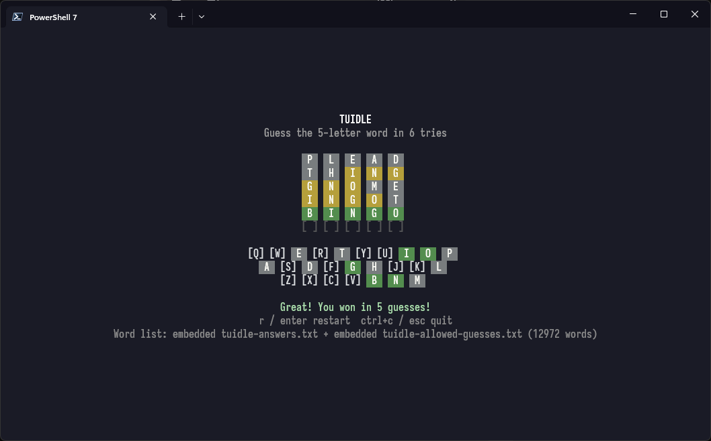

# TUIDLE

Wordle clone in your terminal. This is the Rust port of the original Go
implementation, built with [ratatui](https://ratatui.rs/) and
[crossterm](https://github.com/crossterm-rs/crossterm).

## Requirements

- Rust 1.80 or newer (`rustc --version`)
- A terminal that supports ANSI colours (Windows Terminal, iTerm2, any modern
  Linux terminal, etc.)

## Build & run

```sh
# Just run it
cargo run --release

# Or build the binary:
cargo build --release

./target/release/tuidle          # Linux / macOS
.\target\release\tuidle.exe      # Windows
```

### Tests

```sh
cargo test
cargo clippy --all-targets -- -D warnings
cargo fmt --all -- --check
```

### Cross-compiling

Install the target with rustup, then build with Cargo:

```sh
rustup target add x86_64-unknown-linux-gnu
cargo build --release --target x86_64-unknown-linux-gnu
```

Cross-linking may require a platform linker or a tool such as
[`cross`](https://github.com/cross-rs/cross). On Windows, `build.ps1` builds
for the host by default and `.\build.ps1 -All` attempts all three targets:

```powershell
.\build.ps1          # current host -> build/<os>/tuidle
.\build.ps1 -All     # windows/amd64, linux/amd64, macOS/arm64
```

Optional flags:

```sh
cargo run -- -answers path/to/answers.json  # custom answers/target pool
cargo run -- -guesses path/to/guesses.txt   # custom allowed-guesses list
cargo run -- -words path/to/words.txt       # legacy: same path for both
cargo run -- -target PLEAD                  # force the answer (testing aid)
cargo run -- -version                       # print version and exit
cargo run -- -v                             # alias for -version
cargo run -- -h                             # flag help
```

Flags use the same single-dash spelling as the Go version; `--answers`,
`--answers=path`, and `-answers=path` also work.

### Code layout

| File | Contents |
|------|----------|
| `src/main.rs` | Flags, dictionary loading, terminal setup, event loop |
| `src/model.rs` | `Model` state, `handle_key` / `submit` / `reset`, transient-status and shake timers |
| `src/game.rs` | Pure logic only: `evaluate` (repeated letters), keyboard precedence, win messages — unit-tested without a terminal |
| `src/words.rs` | `tuidle-answers.*` (targets) + `tuidle-allowed-guesses.*` (validation) / embedded / fallback loading, random target picking |
| `src/styles.rs` | Colours and tile styles (green/yellow/gray/active) |
| `src/view.rs` | Ratatui board, keyboard, status, footer, centring, and shake rendering |
| `src/tests.rs` | Table-driven tests for scoring, parsing, submit/restart, quit, timers, and view rendering |

The event loop handles terminal resize events, key presses, and a 250 ms
idle timeout. Transient warnings clear after 1.5 s and an invalid guess
triggers a 50 ms board shake, matching the original behaviour.

### Cross-platform notes

- Crossterm handles raw mode and ANSI input on Linux, macOS, and Windows.
- Tile colours are emitted as RGB values; modern terminals render them
  directly and most others approximate them. Windows Terminal is recommended
  for the best look.
- The UI uses only plain ASCII (solid ` X ` blocks plus `[X]` / `[ ]`
  brackets for not-yet tiles), so it renders correctly in legacy Windows
  code pages as well as modern terminals. There are no `|` outlines, which
  keeps the board from looking like a row of vertical stripes.
- Recommended terminal size is at least 60×20; smaller terminals still work —
  the layout simply is not centred.
- No mouse support is enabled: input is keyboard-only, which keeps behaviour
  identical across terminals.

## Screenshot


